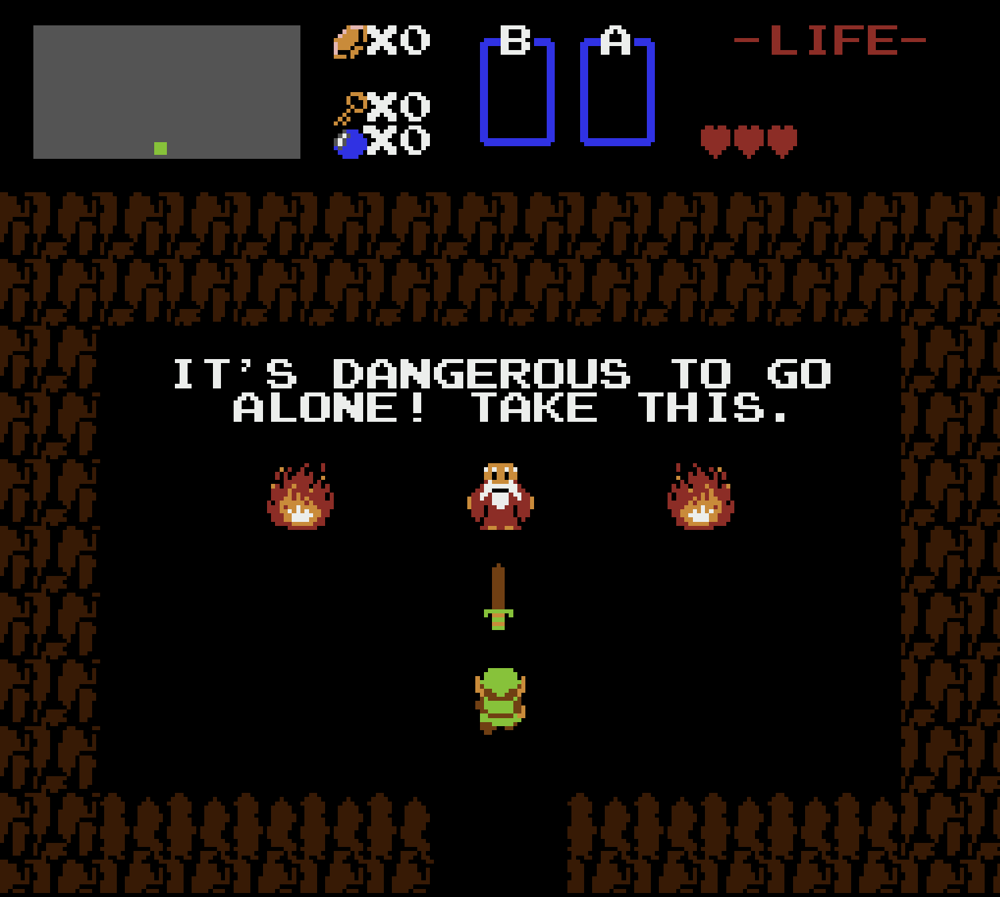
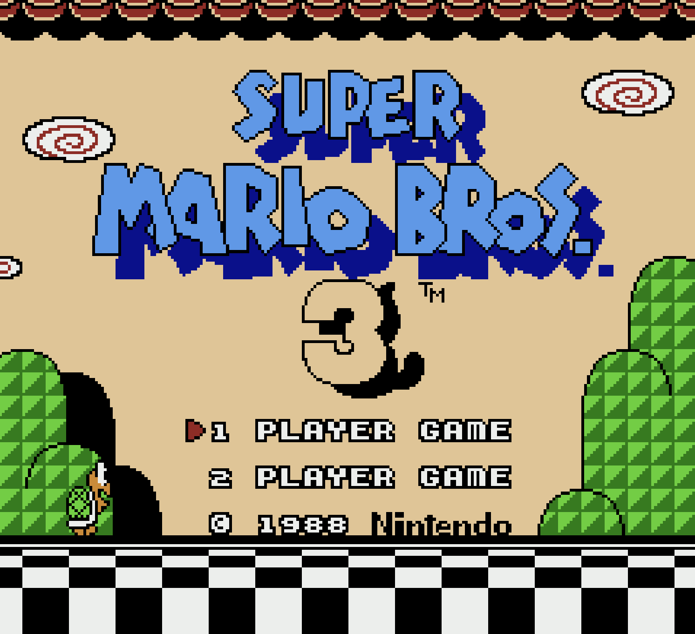
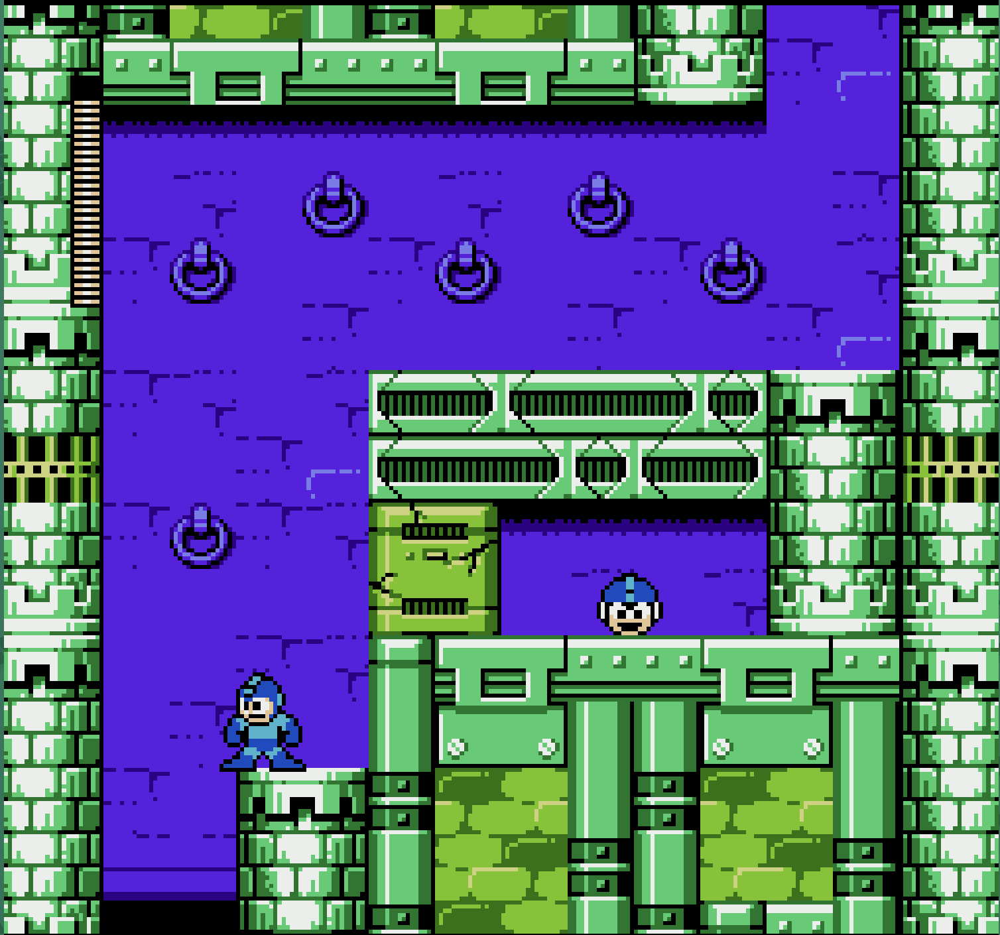
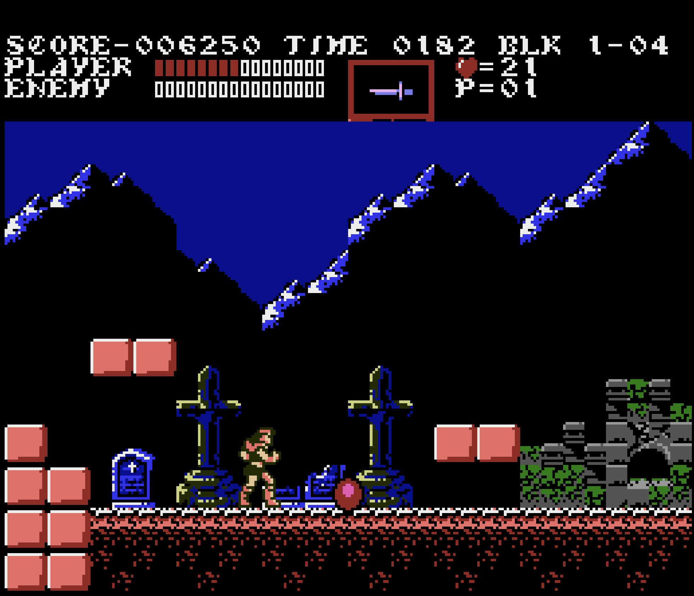

# Transformer NES

An NES emulator built from analytically constructed transformer circuits. CPU instructions, PPU rendering, audio, controller replies and mapper transitions execute in weights; the host schedules and transports their effects.

The project was inspired by Percepta's [WASM-in-a-transformer experiment](https://www.percepta.ai/blog/can-llms-be-computers). A local graph DSL constructs the attention and ReGLU weights. The full model reads a history of memory-write tokens; the compiled runtime serves the same licensed queries from a latest-written byte image.

## Emulator Gallery

These screenshots were captured from the NES emulator running on the compiled transformer-weights backend.

<table>
  <tr>
    <td width="50%"></td>
    <td width="50%"></td>
  </tr>
  <tr>
    <td align="center"><em>The Legend of Zelda</em></td>
    <td align="center"><em>Super Mario Bros. 3</em></td>
  </tr>
  <tr>
    <td width="50%"></td>
    <td width="50%"></td>
  </tr>
  <tr>
    <td align="center"><em>Mega Man 6</em></td>
    <td align="center"><em>Castlevania III</em></td>
  </tr>
</table>

## Prerequisites

- **Python 3.11+**
- **[uv](https://docs.astral.sh/uv/)** package manager
- **C++20 compiler** for the native NES target; the generated 6502 engine is compiled as a C++17 PyTorch extension

The Linux window frontend also needs the OpenGL, X11, XInput, Xcursor and ALSA development packages (`libgl1-mesa-dev libx11-dev libxi-dev libxcursor-dev libasound2-dev` on Ubuntu).

## Quick Start

```bash
uv sync
./vendor/install_deps.sh

# Klaus Dormann functional test suite (all 151 official opcodes + decimal
# mode), full 30.6M-instruction run through the transformer weights:
uv run 6502-klaus --runner weights --max-steps 30700000

# nestest vs the Nintendulator golden log (unofficial opcodes, 2A03 mode,
# registers and cycle counts):
uv run 6502-nestest --runner both

# Export the weights, then run them in a plain PyTorch transformer that
# imports nothing from this repository (about two minutes for nestest):
uv run 6502-export checkpoint/
uv run 6502-checkpoint checkpoint/ --nestest transformer_nes/nes/examples/nestest.nes \
    transformer_nes/nes/examples/nestest.log

# The folded per-opcode experts, routed by opcode in PyTorch (about a second):
uv run 6502-export experts/ --experts
uv run 6502-experts experts/ --nestest transformer_nes/nes/examples/nestest.nes \
    transformer_nes/nes/examples/nestest.log

# Run an NES ROM with the native C++ console hardware:
uv run nes-run path/to/rom.nes

# Replay a captured controller tape headlessly and benchmark it uncapped:
uv run nes-run path/to/rom.nes --tape tapes/game_tape
```

Game ROMs and tape captures are local inputs; the repository includes the nestest verification ROM and log. The `6502-nestest` command expects `nestest.nes` at `transformer_nes/nes/examples/nestest.nes`; `nes-run` accepts a local ROM path and tape path directly.

## Interactive Emulator

Run a ROM without `--tape` to open the interactive emulator window:

```bash
uv run nes-run path/to/rom.nes
```

The default CPU backend is `weights`. Its transformer layers always run through PyTorch Inductor, as do the PPU graphs. Compilation finishes before play and is cached across ROMs. Use `--backend reference` to run the plain-Python CPU instead. The PPU, controller protocol, MMC1/MMC3/MMC2/MMC4/MMC5 banking and MMC3/MMC5 IRQ transitions always run as transformer weights. Add `--xray` to open the overlay on the transformer X-ray.

APU register programming, frame control, envelopes, counters, sweeps, oscillator spans, noise recurrence, digital levels and DMC transitions also run as weights. A float32 ReGLU circuit computes nonlinear DAC mixing, the recurrent DC filter and sample clipping. The host schedules events, delivers DMA bytes and plays the returned samples.

| Key | NES control |
|-----|-------------|
| `X` | A |
| `Z` | B |
| `Tab` | Select |
| `Enter` | Start |
| Arrow keys | D-pad |
| `Esc` | Quit the emulator |
| Grave accent / tilde | Open or close the debug overlay |

### Debug overlay

Press the grave-accent/tilde key to open the Dear ImGui debug window. Press `Esc` while it is open to close the overlay; keyboard input is returned to the game afterward.

The game keeps running and taking input while the overlay is open. It provides:

- **Stats:** display FPS, backend name, frame number, CPU cycles, and emulation time per frame.
- **Options:** toggle overscan cropping, pause emulation, remove the PPU's eight-sprites-per-scanline limit, or mute audio.
- **Step frame:** pause the emulator and advance exactly one frame.
- **Transformer X-ray** (`nes/xray.py`), read live from the running engines:
  - *CPU paths:* how each frame's instructions were retired -- proven loop recurrences, folded instruction shapes, per-opcode experts, interrupt experts, or the full model.
  - *CPU memory:* a 256x256 heatmap of the addresses the CPU's attention heads read.
  - *Instruction dissection:* the next instruction through the full CPU model on a copy of the engine, every named value at the layer that computes it (memory reads with their addresses).
  - *PPU experts:* which folded render expert drew each 8-pixel slot of the frame, optionally tinted over the game picture (the tint stays on with the overlay closed).
  - *Pixel dissection:* click any pixel to trace its tile slot through the full render graph -- the nametable, attribute, pattern and palette reads that produced its color.
  - *Ablation:* knock out any value in that dissection and the render transformer computes without it, in every slot, live.
- **Memory:** inspect the full CPU address space from `$0000` through `$FFFF`. Enter a hexadecimal address in the `addr` field to jump to it.

The CPU views need the weights CPU; pixel views are always available. The `--debug` command-line flag enables verbose logging. Battery-backed saves are loaded from and written to a `.sav` file next to the ROM; tape replays intentionally ignore saves.

## CLI Commands

| Command | Description |
|---------|-------------|
| `6502-reference` | Run a 6502 binary on the plain-Python reference core |
| `6502-klaus` | Klaus Dormann functional test suite (reference / weights) |
| `6502-nestest` | nestest suite vs the Nintendulator golden log (incl. unofficial opcodes) |
| `6502-transformer` | Run the 6502 as real transformer weights, lockstep vs the reference |
| `6502-export` | Write the 6502 transformer as a standalone checkpoint (`weights.safetensors` + `machine.json`) |
| `6502-checkpoint` | Run an exported checkpoint in plain PyTorch against the nestest golden log |
| `6502-experts` | Run the exported per-opcode experts as a routed mixture in PyTorch against the nestest golden log |
| `nes-run` | Run an NES ROM or benchmark a captured input tape on the native console |

The [`transformer_nes/cpu6502/README.md`](transformer_nes/cpu6502/README.md) documents the 6502 machine, including its graph construction, execution backends, compilation pipeline, MMIO/NMI layer, and numerics rules.

## Layout

| Package | Role |
|---------|------|
| `transformer_nes/graph/` | Machine-independent graph DSL: Input/ReGLU/Persist/LookUp dimensions, arithmetic and memory idioms (`ops.py`), direct evaluation (`evaluate.py`), partial evaluation and rebuilding (`fold.py`) |
| `transformer_nes/cpu6502/` | The pure 6502: opcode spec, graph construction, trace format, `backends/reference.py`, the weights compiler/runtime in `backends/weights/` (`engine.py` emits model-specific dispatch into the C++ runtime template in `native/engine.cpp`), the self-contained checkpoint exporter and runners (`export.py`, `checkpoint_runner.py`, `expert_runner.py`), and `examples/klaus/` (harness + binary) |
| `transformer_nes/nes/` | Native C++ NES hardware: bus, cartridge, mapper/MMC headers, PPU, APU, console, tape replay, and the window with its debug overlay; `app.py` builds it, adapts a CPU backend, and launches it; `xray.py` reads the engines for the overlay |
| `transformer_nes/ppu2c02/` | The PPU graphs: memory layout (`space.py`), register transitions (`registers.py`), background rendering and compositing (`render.py`), sprite selection, overflow and fetch (`sprites.py`), scanline timelines (`clock.py`), timing/bus/view effects and sprite-line composition (`control.py`), and the shared engine (`machine.py`) |
| `transformer_nes/model/` | Transformer machinery: layer scheduling (`schedule.py`), analytical weight construction (`weights.py`), shared Torch weight layout and compilation (`torch_layout.py`, `torch_codegen.py`), the generic token-graph engine (`graph_engine.py`), native build/cache support (`build.py`), exact CSR checkpoint serialization (`artifacts.py`), and reference inference (`inference.py`) |

The dependency direction is one-way: `nes/` depends on the NES-independent CPU package; the CPU construction depends on `graph/`, while its weights backend also uses `model/` for scheduling and code generation. The entire generic `model/` package imports without loading the CPU package; a test enforces this. Machine-specific checkpoint export and standalone runners live in `cpu6502/backends/weights/`. The `6502-export`, `6502-checkpoint`, and `6502-experts` commands remain the public entry points.

## Architecture

The graph DSL represents token inputs, linear projections, ReGLU neurons,
attention lookups, and their dependencies. The compiler schedules those
operations into transformer layers and constructs their weights analytically.
There is no parameter training. Equal attention keys select the latest token;
there is no position encoding. Each build has a scoped graph context with its
own node ids and interning caches. Captured graphs survive later builds and
folds without sharing a mutable construction registry.

The CPU's union graph computes the next registers, ordered writes, interrupts,
and instruction cycles. Partial evaluation produces smaller opcode and shape
experts. Every execution expert computes its next PC in weights, including
fallthrough, conditional branches, jumps and returns. Fixed polling and counter
shapes can advance through a proven recurrence after a forward confirms their
state change. Bounded counter experts compute the additional iterations,
registers, flags and elapsed cycles in weights. All paths share the
native run loop's device watches and cycle budgets. The CPU core is independent
of the ROM: it needs no learned instruction windows or online compiler.

Both CPU and PPU use the same Torch compiler. It expands their actual
attention and ReGLU matrices into a fixed bank compiled by Inductor. The graph
fold licenses direct reads over the latest-written byte image before scheduling;
there are no separate nearest-address or register caches. C++ owns dispatch,
architectural readout, event scheduling and byte transport. Constant coefficients and sparse routing are
specialized before play; CPU kernels return packed live readouts, and execution
allocates no weight tensors or per-call Tensor wrappers. The standalone union and expert checkpoint runners remain independent
checks, including ordinary softmax attention.

The first launch compiles the fixed execution banks before play; later launches
load cached binaries. No compiler runs in the background during emulation.

See [the CPU design](transformer_nes/cpu6502/README.md) for construction and
execution contracts, [the source walkthrough](docs/neural-architecture.md)
for the compilation stages, a worked instruction, runtime contracts and research scope.

### The PPU

The PPU host (`transformer_nes/nes/ppu.cpp`) is a catch-up machine on an absolute dot clock. It runs lazily: every register access, mapper write, and console event first catches it up to the dot of that access, so CPU writes are ordered against rendering by time instead of being reconstructed after the frame. Rendering follows the hardware's loopy `v`/`t`/`x`/`w` scroll registers at tile-slot (8-dot) resolution, which covers mid-frame scroll, `$2006` reloads, CHR bank switches, and rendering toggles without per-game split handling. Sprite-0 hits and sprite overflow are timed to the dot, MMC3 counts filtered A12 rises from the actual fetch pattern, MMC5 counts scanline starts, and MMC2/MMC4 latches see fetches in hardware order.

The console loop runs the CPU only up to the next event that must interrupt it: vblank, the frame's end, or a mapper IRQ predicted by a dry run of the PPU. The same dry run tells the engine how long a `$2002` poll result stays valid, so polling loops stay inside the CPU run loop.

Automated tests run the transformer CPU and PPU through blargg's `ppu_vbl_nmi` (10/10), `mmc3_test_2` (5/5 for the supported chip revision), and `oam_read`. See [`transformer_nes/nes/examples/testroms/`](transformer_nes/nes/examples/testroms/README.md).

### The PPU as weights

`transformer_nes/ppu2c02/` builds the PPU as one transformer: a token type per kind of work, all over one memory: an append-only log of WRITE tokens read through the same grouped exact-address attention the 6502 uses, laid out in `space.py` (the CHR windows, the nametable source pages including MMC5's ExRAM and fill mode, palette, OAM).

- **The register file** (`registers.py`, 12 layers): one token per CPU access to `$2000-$2007`, carrying the access and loopy `t`/`v` as their fields (coarse x, coarse y, nametable, fine y). It computes the register file after the access, the value a read returns, and the memory write it makes; `$2007` reads see CHR through the MMC2/MMC4 latches or MMC5's banks.
- **Background rendering and compositing** (`render.py`, 20 layers without extended CHR): one step per 8-pixel tile slot. It reads the nametable, attribute, pattern and palette bytes, fetches the next tile, steps `v`, composites the sprite line by priority, finds sprite-0 hits, and drives the MMC2/MMC4 latches; MMC5's extended attributes read the whole CHR ROM.
- **The sprite unit** (`sprites.py`), in the hardware's two phases per line. *Evaluation* reads all 64 OAM Y bytes through attention and picks the first eight sprites covering the line in OAM order without sorting: with P_i the covering sprites among 0..i, the k-th pick is the number of i with P_i <= k. *Fetch* reads the picked sprites' OAM bytes and pattern rows (vertical and horizontal flips, 8x16 tiles, the MMC2/MMC4 latches each fetch flips in order, MMC5's sprite banks). It returns each row as 8 screen-ordered pixels for the render graph to composite, and the pattern table of every fetch for the mapper's A12 edges. An *overflow* token reads the hardware's diagonal OAM scan and reports its first match. Unlimited-sprite mode repeats selection and fetch in batches of eight, with extra rows prevented from changing CHR latches or the mapper bus.

These token graphs share one engine and memory (`model/graph_engine.py`). Partial evaluation (`graph/fold.py`) produces exact experts for each register and direction, rendering mode, sprite size and fetch count. One blank-state expert removes inactive fetch circuitry while retaining palette output. The host selects an expert whose pins hold, or the full graph. Timing previews project the transformer down to bus or status readouts, removing unused pixel and CHR work before compilation. C++ advances the clock and restores the live register, latch and line-buffer state afterwards.

An eight-lane *composition* token merges fetched sprite rows into the line state, preserving first-opaque-pixel priority, clipping the right edge and marking occupied tiles. It reuses the bounded line buffer across ordinary fetches, unlimited-sprite batches and status previews.

Every production console attaches this PPU automatically. Neural control tokens resolve NMI/status races, filtered A12 edges, register-side latch effects and MMC5 view selection. C++ advances the absolute clock, delivers bus effects and stores output buffers. The conventional PPU algorithms live under `nes/tests/ppu_reference.*` and build only into the independent test oracle; they are excluded from the production extension.

The clock circuit (`clock.py`) returns scanline transitions, frame-wrap effects and ordered event descriptors, including events sharing a dot and the bounds of consecutive tile runs. At attachment the host materializes the five distinct timelines from these weights. Play consumes their readouts without a neural call per dot or a handwritten event table.

Frames stay pixel-identical to the native PPU on every mapper the console supports (NROM, MMC1, MMC3, MMC2/MMC4, MMC5), checked over game captures and synthetic carts that sweep every register path. `model/inference.py` runs constructed graphs exactly in float64 as the verification reference: discrete circuits match exactly, while real-valued audio circuits use measured error tolerances.

## Development

CI builds the console, window frontend and reference oracle on Linux/Python 3.11 and macOS/Python 3.13. Both run the unit and synthetic-console suite; Linux also runs transformer-equivalence tests and the 16 pinned PPU/MMC3 hardware ROMs. Reports are attached to each run. The workflow uses the lockfile and cancels superseded runs.

```bash
uv sync --extra dev

# Fast tests
uv run pytest -m "not slow"

# All tests (includes generated-engine builds and full-suite runs)
uv run pytest

# Lint
uv run ruff check .
```
